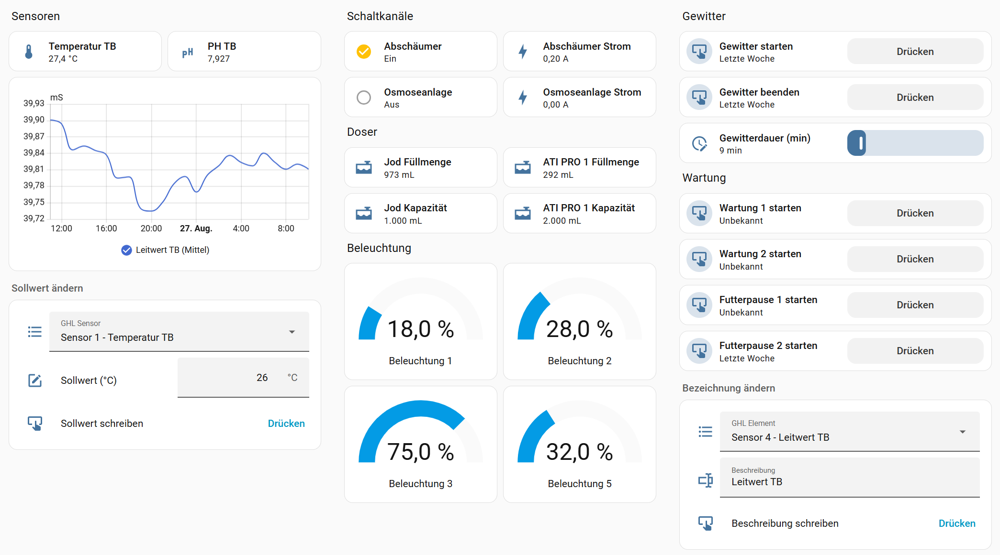
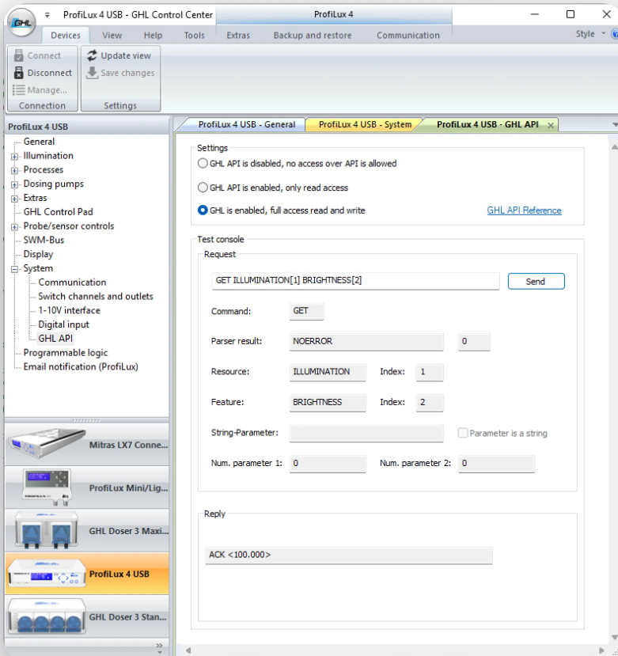

[English](../README.md) · **Deutsch** · [Français](README.fr.md) (maschinell übersetzt) · [Español](README.es.md) (maschinell übersetzt)

  

<h1 align="center">GHL</h1>

  Eine benutzerdefinierte Home-Assistant-Integration für ausgewählte GHL-Aquariencomputer und -Leuchten.

---

## Über die Integration

Diese benutzerdefinierte Integration verbindet unterstützte GHL-Geräte über die GHL API direkt mit Home Assistant.

Abhängig vom angeschlossenen Gerät und den von der GHL API bereitgestellten Funktionen kann die Integration Messwerte, Zustände, Bedienelemente und Aktionen in Home Assistant bereitstellen.

So lassen sich GHL-Daten und -Funktionen in Dashboards, Automationen und anderen Funktionen von Home Assistant verwenden.

  

## Haftungsausschluss

Dies ist eine inoffizielle Home-Assistant-Integration. Sie wird nicht von GHL entwickelt, gepflegt oder unterstützt.

Die Integration wird privat entwickelt und ohne Gewähr bereitgestellt.

Die Integration kann ausschliesslich Funktionen bereitstellen, die über die offizielle GHL API verfügbar sind. Funktionen oder Informationen, die die GHL API nicht anbietet, können durch diese Integration nicht bereitgestellt werden.

Informationen zur GHL API und ihren Möglichkeiten findest du unter: https://www.aquariumcomputer.com/software/ghl-api/

> [!WARNING]
> Diese Integration befindet sich in Entwicklung.

> [!TIP]
>
> Wenn du diese Integration nützlich findest und ihre Entwicklung unterstützen möchtest
>

  

## Unterstützte Geräte

Die folgenden GHL-Geräteserien werden unterstützt:

- ProfiLux-4-Serie (einschliesslich Industrial Line / IL)
- Mitras-LX8-Serie
- Mitras-LX7-Serie (einschliesslich Industrial Line / IL)

Folgende Firmwareversionen werden benötigt:

- ProfiLux 4: Firmware 7.52
- Mitras LX7: Firmware 1.22
- Mitras LX8: Firmware 2.05

Die Unterstützung durch diese Integration beschränkt sich auf die Funktionen, die die GHL API für das jeweilige Gerät bereitstellt.

> [!NOTE]
> Die aktuell von dieser Integration verwendete API-Version ist **1.1**.

## Installation

### HACS

Die Installation über HACS wird empfohlen.

Nachdem du das Repository zu HACS hinzugefügt hast:

1. Installiere die Integration **GHL**.
2. Starte Home Assistant neu.
3. Öffne **Einstellungen → Geräte & Dienste**.
4. Wähle **Integration hinzufügen**.
5. Suche nach **GHL**.

### Manuelle Installation

Alternativ kannst du die neueste Version von GitHub herunterladen.

Kopiere den Ordner `pcs_ghl` aus `custom_components` in das Verzeichnis `custom_components` deiner Home-Assistant-Installation.

Starte Home Assistant anschliessend neu und füge die Integration hinzu unter:

**Einstellungen → Geräte & Dienste → Integration hinzufügen → GHL**

## GHL API aktivieren

Die GHL API ist standardmässig deaktiviert und muss aktiviert werden, bevor Home Assistant mit dem Gerät kommunizieren kann.

Aktiviere den API-Zugriff unter **GHL Control Center → System → GHL API**.

Für den vollständigen Funktionsumfang dieser Integration, einschliesslich des Schreibens von Werten und Startens von Aktionen, wähle:

**GHL API ist aktiviert, Vollzugriff Lesen und Schreiben**

API-Zugriff im Nur-Lesen-Modus wird ebenfalls unterstützt. Funktionen, die Schreibzugriff benötigen, beispielsweise das Starten oder Beenden von Wartungen oder Futterpausen, stehen bei einem auf Nur-Lesen konfigurierten API-Zugriff jedoch nicht zur Verfügung.

  

Nach einem Firmwareupdate muss die GHL API möglicherweise erneut aktiviert werden. Falls die Integration nach einem Firmwareupdate nicht mehr mit dem Gerät kommunizieren kann, prüfe zuerst diese Einstellung.

Weitere Informationen zur Aktivierung der GHL API findest du hier:

https://www.aquariumcomputer.com/software/ghl-api/

## Konfiguration

Gib beim Hinzufügen der Integration in Home Assistant die Netzwerkangaben deines GHL-Geräts ein und wähle den gewünschten API-Zugriffsmodus.

Die Integration verbindet sich mit dem Gerät und erkennt die unterstützten GHL-Ressourcen.

Da die GHL API den Typ eines angeschlossenen Sensors nicht bereitstellt, fordert dich die Integration während der Einrichtung auf, den erkannten Sensoren den passenden Typ zuzuweisen.

Nach der Ersteinrichtung stehen weitere Konfigurationsmöglichkeiten zur Verfügung unter:

**Einstellungen → Geräte & Dienste → GHL → Konfigurieren**

## Optionen

Die Integration bietet nach der Ersteinrichtung zusätzliche Optionen.

> [!NOTE]
> Einige Optionen stehen erst nach einer erfolgreichen Verbindung zum GHL-Gerät und nach dem Laden der Integration zur Verfügung.

### Allgemeine Einstellungen

Die Verbindungseinstellungen können bei Bedarf angepasst werden.

Der API-Zugriffsmodus kann ebenfalls zwischen Nur-Lesen und Lesen/Schreiben gewechselt werden.

#### Alle verfügbaren Ressourcen anzeigen

Diese Option ist nach der erstmaligen Einrichtung der Integration verfügbar.

Standardmässig verwendet die Integration die Gerätekonfiguration, um GHL-Ressourcen, die unbenutzt erscheinen, nicht anzuzeigen.

Durch Aktivieren dieser Option werden auch unterstützte Ressourcen angezeigt, die aufgrund der Gerätekonfiguration normalerweise als unbenutzt erkannt und deshalb ausgeblendet würden.

Das ist hilfreich, wenn du bewusst alle unterstützten Ressourcen, die das GHL-Gerät meldet, in Home Assistant anzeigen möchtest.

#### Historische Daten für neue Sensoren importieren

Aktiviere diese Option, um historische Daten automatisch zu importieren, wenn unterstützte Sensoren oder Quellen erstmals erkannt und konfiguriert werden. Ein späteres Aktivieren dieser Option importiert nicht automatisch Daten für bereits vorhandene Quellen.

### Sensorkonfiguration

Die bei der Ersteinrichtung zugewiesenen Sensortypen können später über die Integrationsoptionen geändert werden.

So lässt sich die Sensorkonfiguration korrigieren oder anpassen, ohne die Integration zu entfernen und erneut einzurichten.

### Neue Sensoren/Geräte erkennen

Wähle nach dem Hinzufügen von Sensoren oder Geräten zu deinem GHL-System in den Integrationsoptionen „Neue Sensoren/Geräte erkennen“.
Dadurch wird die Integration neu geladen und die Ressourcenerkennung erneut ausgeführt. Ein Neustart von Home Assistant ist nicht erforderlich. Neu erkannten Sensoren muss möglicherweise ein Sensortyp zugewiesen werden.

### Historische Daten importieren

Um gespeicherte Daten für alle aktuell verfügbaren und unterstützten Quellen manuell zu importieren, wähle in den Integrationsoptionen **Historische Daten: jetzt importieren**.
Sensoren ohne zugewiesenen Typ sowie als verborgen konfigurierte Sensoren werden ausgeschlossen. Die Duplikaterkennung hilft zu verhindern, dass dieselben historischen Daten mehrfach importiert werden.
Der Import einer grossen Menge gespeicherter Daten kann mehrere Minuten dauern.

## Werte über Home Assistant ändern

Einige von der GHL API bereitgestellte Werte und Beschreibungen können direkt über die Benutzeroberfläche von Home Assistant geändert werden.

Für Änderungen ist Schreibzugriff sowohl am GHL-Gerät als auch in der Integration erforderlich. Im Nur-Lesen-Modus werden Sensorsollwerte angezeigt, Änderungen jedoch mit einem entsprechenden Hinweis abgewiesen. Das Bedienelement für die Gesamthelligkeit ist im Nur-Lesen-Modus nicht verfügbar.

Für diese Bedienelemente wird eine **Entitäten-Karte** empfohlen.

### Sensorsollwerte

Ändere den Wert im Sollwertfeld des gewünschten Sensors. Der Wert wird direkt an das GHL-Gerät gesendet. Dies gilt auch für unterstützte Sollwerte von KH Director und ION Director.

### Gesamthelligkeit

Ändere den Wert der Gesamthelligkeit (0–100 %). Der Wert wird direkt an das GHL-Gerät gesendet.

### Beschreibungen

Beschreibungen unterstützter GHL-Elemente können ebenfalls direkt über Home Assistant geändert werden.

So änderst du eine Beschreibung:

1. Wähle das gewünschte GHL-Element aus.
2. Gib die neue Beschreibung im Feld **Beschreibung** ein.
3. Drücke **Beschreibung schreiben**.

Eine Home-Assistant-Automation ist dafür nicht erforderlich. Du kannst aber eine verwenden.

## Aktuelle Einschränkungen

Die Integration ist durch die Funktionen und Informationen begrenzt, die die GHL API bereitstellt.

Zu den aktuell bekannten Einschränkungen gehören:

- **Sensortypen können nicht über die GHL API ausgelesen werden.**  
  Der Sensortyp muss deshalb während der Einrichtung separat zugewiesen werden. Die Zuweisung kann später über die Integrationsoptionen geändert werden.

- **Zeitschaltuhren werden derzeit nicht importiert.**  
  Die GHL API stellt die Beschreibung der Zeitschaltuhr bereit, jedoch nicht deren Schaltzeiten. Der Import von Zeitschaltuhren würde daher aktuell nur wenig nützliche Funktionalität in Home Assistant bieten.

## Probleme und Funktionswünsche

Wenn du ein Problem findest oder eine Idee zur Verbesserung der Integration hast, verwende bitte die GitHub-Issue-Formulare.

**Fehlermeldungen:**  
https://github.com/PC-Supporting-GmbH/HomeAssistant-GHL/issues/new?template=bug_report.yml

**Funktionswünsche:**  
https://github.com/PC-Supporting-GmbH/HomeAssistant-GHL/issues/new?template=feature_request.yml

Prüfe vor dem Eröffnen eines neuen Issues, ob dasselbe Problem oder derselbe Wunsch bereits gemeldet wurde.
